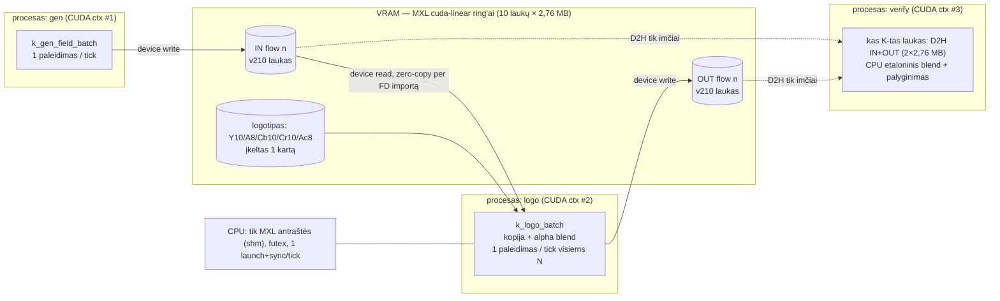
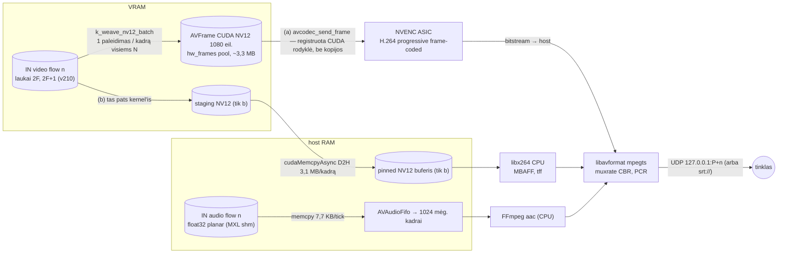
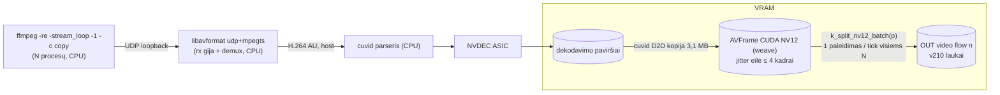
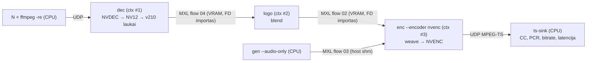

# GPU media funkcijos virš MXL (`vramflow-func`) — architektūra ir pajėgumo matavimo planas

- **Data:** 2026-11-10
- **Tikslas:** išmatuoti realų šios mašinos pajėgumą — kiek vienalaikių 1080i50 signalų galima priimti, laikyti VRAM kaip MXL flow'us, apdoroti ir išvesti, CPU darant kuo mažiau.
- **Rezultatas:** vienas naujas vykdomasis `vramflow-func` (subkomandos `gen`, `logo`, `enc`, `dec`, `verify`, `ts-sink`, `bench`) + pajėgumo harness `tests/perf/capacity.py`.
- **Skaitytojas:** įgyvendintojas. Dokumentas turi būti pakankamas koduoti be spėjimų. Remiasi `2026-11-10-vramflow-verify.md` (toliau — **[V]**); jo W1–W13 / RD1–RD12 sekos čia nekartojamos, tik papildomos.
- **Šiame etape nieko nediegta, nebuild'inta ir nepaleista** — visi skaičiai §8 yra prognozės, ne matavimai.

Žymėjimas: **[patikrinta: šaltinis]** — perskaityta šaltinyje 2026-11-10 (MXL: `thomastrue/mxl` SHA `6dddc91d`; FFmpeg: tag `n6.1.1`). **[išmatuota]** — užsakovo matavimas šioje mašinoje 2026-11-10. **[prielaida]** — nepatikrinta, nurodyta, kuri užduotis (§10) tai patvirtina. **[sprendimas]** — mūsų dizaino pasirinkimas.

---

## 0. Svarbiausi radiniai (skaityti pirmiausia)

| # | Radinys | Šaltinis |
|---|---|---|
| G1 | Interlaced flow: `interlace_mode` ∈ {`interlaced_tff`,`interlaced_bff`} leidžiamas tik kai `grain_rate` = 25/1 arba 30000/1001; parseris **padvigubina** skaitiklį (antraštėje `grainRate` = 50/1), payload = `getV210LineLength(w) · h/2`, slice'ų = `h/2`; aukštis privalo būti lyginis. 1080i50: grain = 5120·540 = **2 764 800 B**, 540 slice'ų. | [patikrinta: `lib/internal/src/FlowParser.cpp:288-307,339-343,485-489`; `MediaUtils.cpp:8-11`] |
| G2 | Ring'as: `grainCount = historyDuration·num/(1e9·den)` skaičiuojamas **jau padvigubintu** dažniu → 10 laukų (200 ms), skaitomi 9. Vieno 1080i50 flow VRAM = 10 · 2 764 800 = **27,65 MB** (+ apvalinimas iki VMM granuliarumo). | [patikrinta: `Instance.cpp:295-297`; [V] §1] / [prielaida: granuliarumo dydis — T1] |
| G3 | **MXL niekur neapibrėžia lauko pariteto** (kuris indeksas — viršutinis laukas). Nei `docs/`, nei `flow.h`, nei `mxlGrainInfo` to neturi. Visi `tools/mxl-gst/*` interlaced flow'us **atmeta** („does not support interlaced flows"). Paritetą apibrėžiame patys (§2.1). | [patikrinta: grep „interlac/field/parity" per `docs/*.md`, `flow.h`; `testsrc.cpp:865-867`, `cuda_testsrc.cpp:439-441`, `sink.cpp:1417-1419`] |
| G4 | Continuous (audio) flow: tik host atmintis — backend'o prašymas → `MXL_ERR_UNSUPPORTED_OPERATION`. `bit_depth` 32 arba 64, planarinis float (kanalų buferiai vienas po kito, `stride = wordSize·bufferLength`). `bufferLength = history·rate/5e8`, apvalinta iki 4096 B puslapio: 48 kHz → 19 200 → **19 456** mėginių; skaitoma/rašoma vienu kartu ≤ `bufferLength/2` = 9 728 (202,7 ms). | [patikrinta: `Instance.cpp:321-340`; `FlowParser.cpp:397-409`; `PosixContinuousFlowWriter.cpp` `openSamples`; `PosixContinuousFlowReader.cpp:55,124-160`] |
| G5 | `OpenSamples(index,count)` / `GetSamples(index,count)`: buferio pozicijos `[index−count, index)` mod `bufferLength`; rašytojui privaloma `index > lastCommitted` ir `index−count ≥ lastCommitted`. `mxl-gst` sink pirmą mėginį laiko `index−count+1` (1 mėginio = 20,8 µs dviprasmybė; mums nereikšminga, bet konvencija užfiksuota §2.2). | [patikrinta: `PosixContinuousFlowWriter.cpp` `openSamples`; `tools/mxl-gst/sink.cpp:665`] |
| G6 | `mxl-gst-testsrc` **gali** rašyti tik audio flow (`-a audio_flow.json` be `-v`): sinusas, float32. Mes vis tiek rašome audio patys (`gen`), kad nereikėtų GStreamer ir kad turėtume A/V sinchronizacijos žymes. | [patikrinta: `docs/Tools.md` „Example to run with audio only"; `testsrc.cpp:903-935`] |
| G7 | Sinchroninio laukimo primityvas keliems flow'ams: `mxlFlowSynchronizationGroupAddReader` + `mxlFlowSynchronizationGroupWaitForDataAt(group, timestamp, timeoutNs)`. Tinka „tick" architektūrai (§3). | [patikrinta: `flow.h:929-1019`] / [prielaida: veikia su backend (v2) flow'ais — T4; atsarginis kelias — `GetGrainSlot` su trumpu timeout] |
| G8 | NVENC Ada **neturi** H.264 lauko kodavimo (Ampere/TU, Ada — ne; Maxwell, Pascal, Volta/TU117 ir **Blackwell — taip**). Sutampa su mūsų probe (`field_encoding = 0`). `h264_nvenc` su `AV_CODEC_FLAG_INTERLACED_DCT` šioje kortoje grąžina `ENOSYS` („Interlaced encoding is not supported"). | [patikrinta: NVENC Application Note, Video Codec SDK 13.0; `libavcodec/nvenc.c:496-499,1638-1641`] [išmatuota: `probe/nvenc_caps.cpp`] |
| G9 | Sesijų riba GeForce: support matrix — **12**; Application Note 13.0 tekste vis dar „8 per system". Mūsų matavimas — 12 (13-a nepavyksta). Tikėti matavimu. L4 / L40S / RTX Ada / RTX PRO — „Unrestricted". | [patikrinta: developer.nvidia.com/video-encode-decode-support-matrix; NVENC App Note 13.0] [išmatuota] |
| G10 | `h264_cuvid` numatytas `deint` = **weave** („do nothing"): abu laukai vienoje NV12 plokštumoje; kadras gauna `AV_FRAME_FLAG_INTERLACED` kai seka ne progresyvi, `TOP_FIELD_FIRST` iš parserio `top_field_first`. `hwaccel` kelias (`nvdec.c`) visada `progressive_frame=1` (jokio deinterlace) ir laiko **1** išvesties paviršių, nebent „unsafe output". | [patikrinta: `libavcodec/cuviddec.c:233-242,339-344,397-406,668-672,1130-1136`; `nvdec.c:400-401,497`] |
| G11 | FFmpeg 6.1.1 `nvenc.c` **neįjungia** filler data CBR režimu → video ES nėra griežtai pastovus; TS pastovumą užtikrina `mpegts` `muxrate` (null paketai). | [patikrinta: `nvenc.c` n6.1.1 — `enableFillerDataInsertion` nėra; `mpegtsenc.c:2311`] |
| G12 | `libx264` wrapper'is interlaced įjungia per `AV_CODEC_FLAG_INTERLACED_DCT` (`b_interlaced`), lauko tvarką ima iš kadro `AV_FRAME_FLAG_TOP_FIELD_FIRST`; `nal-hrd=cbr` palaikomas. | [patikrinta: `libavcodec/libx264.c:205-207,1152,1406-1410`] |

**Optimizacijos, kurias siūlau aktyviai (ne tik įgyvendinu užduotį):**

1. **Batch'inti per flow'us, ne po kernel'į kiekvienam flow.** Išmatuota: vieno GPU veiksmo p50 ≈ 1,5 ms dėl WDDM launch/sync, pats kernel'is — dešimtys µs [išmatuota]. Visi flow'ai dalijasi tuo pačiu TAI indeksų tinkleliu, todėl vienas „tick" = **vienas** kernel'io paleidimas visiems N flow'ams (rodyklių lentelė perduodama kaip kernel'io argumentas by-value, ≤ 4 KiB). Paleidimų skaičius — 50/s nepriklausomai nuo N, vietoje 50·N. [sprendimas]
2. **x264 keliui nereikia atskiro `yuv420p` kernel'io:** `libx264` priima `AV_PIX_FMT_NV12` ir viduje chromą laiko persluoksniuotą — tas pats weave→NV12 kernel'is tinka abiem keliams, x264 išvengia de-interleave kopijos. [prielaida: `libx264.c` `pix_fmts_8bit` turi NV12 — T9; jei ne — `--x264-pixfmt yuv420p` su papildomu kernel'io variantu]
3. **`libswresample` nereikalingas:** MXL audio jau yra planarinis float32 = `AV_SAMPLE_FMT_FLTP`, kurio ir reikia FFmpeg `aac`. Link'inamas (kaip prašyta), bet duomenų kelyje nenaudojamas. [patikrinta: `aacenc.c:1444` `sample_fmts = FLTP`; G4]

---

## 1. Terminai ir bendros konstantos

| Dydis | Reikšmė | Kilmė |
|---|---|---|
| Lauko grain | 1920×540, v210, 5120 B/eil., 2 764 800 B, 691 200 × `uint32` | G1 |
| Lauko dažnis | 50/1 (`cfg.common.grainRate`), periodas 20 000 000 ns | G1 |
| Kadras F | laukai `2F` (viršutinis) ir `2F+1` (apatinis) | §2.1 [sprendimas] |
| NV12 kadras | 1920×1080 Y + 1920×540 UV; pitch imamas iš `AVFrame.linesize[]` (hwcontext_cuda lygiuoja — **niekada nehardcode'inti 1920**) | [prielaida: lygiavimas 256 → pitch 2048; T7 patikra `linesize[0] ≥ 1920`] |
| Audio | 48 000 Hz, 2 kan., float32 planar; 960 mėginių/laukui, 1920/kadrui (sveiki skaičiai, nes abu tinkleliai nuo TAI epochos) | G4 |
| 90 kHz PTS | laukas = 1800 tikų, kadras = 3600, audio mėginys = 15/8 tiko | §5.3 |

Bendri resursai iš esamo kodo (perkelti į bendras antraštes, ne kopijuoti): `Histogram` (`src/common/histogram.hpp`), `now_tai_ns`, `cuda_uuid_string`, `cuda_device_by_uuid`, `writer_options` (`src/mxlio/common_io.*`), `slot_ptr`/`is_cuda_layout` (`src/mxlio/slots.hpp`), `wait_until_index` (iš `verify_writer.cpp:54-63` iškelti į `src/mxlio/timing.hpp`), `lapped()`/`slot_of()` (`src/common/index_math.hpp`), `crc32c`.

---

## 2. Konvencijos, kurių MXL neapibrėžia [sprendimas]

### 2.1 Lauko paritetas ir eilučių atitikimas

- Flow `interlaced_tff`: **lyginis grain indeksas = viršutinis laukas** (pirmas laike), nelyginis = apatinis. `F = index >> 1`, `p = index & 1`.
- Lauko `p` eilutė `j` (0..539) ↔ kadro eilutė `2j + p`.
- Kadro F laiko žyma = `mxlIndexToTimestamp(50/1, 2F)`.
- Kadangi indeksas išvedamas iš TAI, paritetas yra globalus: visi procesai sutaria be jokio papildomo signalizavimo. Rizika: kitas MXL įrankis gali pasirinkti kitaip (G3) — todėl kiekvienas mūsų laukas neša **žymę** (§6.1), o `verify` tikrina `žymės paritetas == index & 1`.
- flow_def (video): kaip `flow_def_json()` (`common_io.cpp:30-45`), bet `"grain_rate":{"numerator":25,"denominator":1}`, `"interlace_mode":"interlaced_tff"`, `frame_height` 1080. Po `mxlCreateFlowWriter` **privaloma patikrinti**: `cfg.common.grainRate == 50/1`, `cfg.discrete.grainCount == 10`, `layout.planes[0].size == 2764800`, `info.totalSlices == 540`; neatitikus — exit 2.

### 2.2 Audio

- flow_def pagal `lib/tests/data/audio_flow.json`: `format urn:x-nmos:format:audio`, `media_type audio/float32`, `sample_rate {numerator:48000}`, `channel_count 2`, `bit_depth 32`, netuščias `label`, grouphint `"<grupė>:Audio n"` (ta pati grupė kaip video `n`), `source_id`/`device_id` — deterministiniai UUID. [patikrinta: failas] / [prielaida: `source_id`/`device_id` neprivalomi — paliekame]
- Rašytojo opcijos: `NULL` (host). Mėginio su TAI indeksu `s` vieta — buferio pozicija `s mod bufferLength`; blokas `[s_end−count, s_end)`.
- Kiekvienas rašymas/skaitymas: 2 fragmentai × 2 kanalai; kanalo `c` adresas = `fragment.pointer + c·stride` [patikrinta: `testsrc.cpp:688-692`; `sink.cpp:653-659`].

### 2.3 Flow identifikatoriai

`4d584c47-00RR-4000-8000-%012x` (n): `RR=01` gen video, `02` logo out, `03` gen audio, `04` dec out. Label `vramflow-func <rolė> n`, grouphint `vramflow-func-<run_seed hex>:Video n` / `:Audio n`.

---

## 3. Bendras vykdymo modelis: „tick" variklis

Visos funkcijos turi **vieną tick giją**, kuriai priklauso visi to proceso MXL handle'ai (handle'ai ne thread-safe [V] §1) ir vienas `cudaStream_t`. Darbininkų gijos (kodavimas, mux, dekodavimas) MXL nekviečia.

```
tick(index i):                                   // i — lauko indeksas (LOGO, GEN, DEC) arba 2F+1 (ENC)
  1. wait_until_index(i)  +  --read-offset-us (numatyta 500)        // niekada nerašom anksčiau už T(i)
  2. mxlFlowSynchronizationGroupWaitForDataAt(group, T(i), deadline−now)   // G7; atsarginis: ciklas per GetGrainSlot
  3. kiekvienam flow n: GetGrainSlot(reader[n], i, ALL, 0, &info, &slot)   // timeout 0
       OK            → į batch'ą
       OK+INVALID    → in_invalid[n]++, flow praleidžiamas šiam tick'ui
       TOO_EARLY     → į „pending"; kartoti kas 1 ms iki deadline = T(i)+--deadline-ms (numatyta 15)
       TOO_LATE      → late_fields[n] += head−i (šuolis), žr. [V] §4.5 politiką
       FLOW_INVALID  → reopen kaip [V] RD-REOPEN; reopens[n]++
  4. kiekvienam batch'o flow: OpenGrainSlot(writer[n], i, &oinfo, &oslot)  // INVALID_ARG ir i ≤ last → clock_backward++
  5. VIENAS kernel'io paleidimas visam batch'ui → cudaStreamSynchronize(stream)
  6. lap patikra kiekvienam įėjimui: lapped(max(head, now_idx), i, grainCount) → CancelGrain, lapped[n]++
  7. CommitGrain(writer[n], &oinfo) (validSlices = totalSlices)            // commit tik po sync ([V] „commit kontraktas")
  8. pending flow'ai, sulaukę iki deadline → antras mini-batch (5–7); nesulaukę → late_fields[n]++ , išėjimo grain'as
     NEcommit'inamas (MXL kitą commit'ą pažymės INVALID, [V] R9) → dropped_fields[n]++
  9. jei mxlGetCurrentIndex() > i+1 → writer_late_skips += skirtumas; i = now (praleisti, ne vytis)
```

Taisyklės: (a) **niekas nedingsta tyliai** — kiekvienas indeksas yra arba `fields_ok`, arba vienas iš `late/dropped/in_invalid/lapped` skaitiklių; pabaigoje `Σ == span` tikrinama kaip `coverage` ([V] `finalize_exit` principas). (b) Laikrodžio šuolis atgal → laukti, ne bėgti į priekį (`wait_until_index`, [išmatuota: ~1,2 s šuolis]). (c) Išėjimo indeksas **= įėjimo indeksas** (išsaugo paritetą ir laiką; vėlavimas matomas kaip commit laiko, ne indekso, poslinkis).

Batch'o argumentas (by-value, be H2D kopijos): `struct Batch { uint32_t n; uint32_t pad; Job job[kMaxBatch]; }`, `kMaxBatch = 64`; didžiausias `Job` — 4 rodyklės (32 B) → 2056 B < 4096 B kernel'io argumentų ribos [prielaida: CUDA 4 KiB riba — T3 kompiliacija ją patvirtina]. N > 64 → keli paleidimai.

CUDA kontekstas: `cudaSetDevice(dev)` tick gijoje; FFmpeg gauna **tą patį primary kontekstą**: `av_hwdevice_ctx_create(&hw, AV_HWDEVICE_TYPE_CUDA, "<ordinal>", NULL, AV_CUDA_USE_PRIMARY_CONTEXT)` — MXL plugin'o importuotos rodyklės, mūsų kernel'iai ir NVENC/NVDEC kadrai gyvena viename kontekste, jokio `cuCtxPush/Pop` tarp jų. [prielaida: `AV_CUDA_USE_PRIMARY_CONTEXT` yra Ubuntu 6.1.1 `hwcontext_cuda.h`; plugin'as naudoja primary ctx ([V] P0.4) — T7 patikra: `cudaPointerGetAttributes(frame->data[0])` grąžina device tipą mūsų gijoje]

---

## 4. Duomenų keliai

### 4.1 F-LOGO



Baitai: pikseliai niekada nepalieka VRAM, išskyrus `verify` imtį. CPU: indeksų aritmetika, `GetGrainSlot`/`Commit` (shm antraštės), vienas kernel'io paleidimas ir vienas `cudaStreamSynchronize` per 20 ms.

### 4.2 F-ENC (a) NVENC ir (b) x264



### 4.3 F-DEC



### 4.4 Grandinė F-DEC → F-LOGO → F-ENC(a)



Vienam signalui VRAM: dec paviršiai + NV12 pool + flow 04 (27,65 MB) + flow 02 (27,65 MB) + enc NV12 pool + NVENC sesija. Host: tik suspaustas srautas (≈1 MB/s) ir audio.

---

## 5. Funkcijos: tikslios API sekos

### 5.1 `gen` — apkrovos generatorius

`vramflow-func gen --domain D --flows N [--video 1|0] [--audio 1|0] --duration S --complexity 0..3 --run-seed U64`

- Video: tick variklis be įėjimų (žingsniai 1, 4, 5, 7, 9); kernel'is `k_gen_field_batch` (§6.5). Rašymo seka — [V] W1–W13 su §2.1 patikromis.
- Audio (tick gijoje, kas lauką): `mxlCreateFlowWriter(inst, audioDef, NULL, &w, &cfg, &created)`; patikra `cfg.continuous.channelCount == 2`, `mxlFlowWriterGetMaxWriteLengthSamples ≥ 960`. Kas tick `i`: `s_end = i·960` → `mxlFlowWriterOpenSamples(w, s_end, 960, &sl)` → užpildyti abu fragmentus abiem kanalams → `mxlFlowWriterCommitSamples(w)`. Turinys: 1 kHz sinusas −20 dBFS; mėginiams su `s mod 48000 < 480` (10 ms nuo sekundės ribos) — −6 dBFS (**sync pyptelėjimas**). `INVALID_ARG` (indeksas ≤ paskutinis) → `clock_backward++`, praleisti.
- Video žymė ir **sync blyksnis**: laukuose su `index mod 50 == 0` stačiakampis (x 1600..1856, lauko eil. 32..96) Y=940; kitur Y=64 (§6.1).

### 5.2 `logo` — F-LOGO

`vramflow-func logo --domain D --flows N --in-role 01|04 --logo FILE.png|builtin --logo-x X --logo-y Y`

1. Logotipas (CPU, vieną kartą): PNG dekoduojamas per `libavformat`+`libavcodec` (`image2`/`png`; priimami tik `rgba`/`rgb24`, kitaip exit 1) arba `builtin` (procedūrinis 384×216 su alfa gradientu). Reikalavimai: `X % 2 == 0`, logotipo plotis lyginis, telpa į 1920×1080; kitaip exit 1. Konversija §6.3 → 5 plokštumos → `cudaMalloc` + `cudaMemcpy` H2D.
2. Atidaryti N reader'ių ([V] RD1–RD7) ir N writer'ių ([V] W1–W8, flow `02`), `mxlCreateFlowSynchronizationGroup` + `AddReader` × N.
3. Tick ciklas §3; `Job = {const uint32_t* src; uint32_t* dst;}`; kernel'is `k_logo_batch(batch, parity = i & 1, LogoDesc)`.
4. Latencija: `proc_ms = t_commit − t_wake` (histograma), `out_lateness = t_commit − T(i)`.

Atsilikimo elgsena: §3 8–9 žingsniai. `--deadline-ms` 15 (< lauko periodo, kad kitas tick nevėluotų).

### 5.3 `enc` — F-ENC

`vramflow-func enc --domain D --flows N --in-role 01|02 --encoder nvenc|x264 --out udp://127.0.0.1:{port}?pkt_size=1316 --port-base 20000 --vbitrate 7500000 --abitrate 192000 --muxrate 8500000`

**Gijos:** 1 tick gija (MXL + kernel'is) + N darbininkų (po vieną srautui: video kodavimas, AAC, mux, siuntimas). Darbininkas turi ribotą eilę (video 4 kadrai, audio 16 blokų). NVENC FFmpeg'e sinchroninis (`async_encode = 0` [išmatuota]) — `avcodec_send_frame`/`receive_packet` blokuoja, todėl N sesijų lygiagrečiai reikalauja N gijų; jos beveik visą laiką miega.

**Tick (kadro ritmu, `i = 2F+1`):** §3 su dviem įėjimais vienam flow — `GetGrainSlot(2F)` ir `GetGrainSlot(2F+1)` (viršutinis laukas dar ring'e: 20 ms senumo iš 180 ms lango). `Job = {top, bot, dstY, dstUV}`; paskirtis — `av_hwframe_get_buffer(frames_ref[n], frame, 0)` → `frame->data[0]`, `data[1]`, pitch `linesize[0]` (patikra: visų srautų pitch vienodas; kitaip atskiri batch'ai). Po sync ir lap patikros abiem laukams: `frame->pts = F`, į srauto eilę. Eilė pilna → `frames_dropped_queue[n]++`, kadras atmetamas (PTS tarpas matomas imtuve). Tame pačiame tick'e — audio: kiekvienam lauko tick'ui `mxlFlowReaderGetSamples(ar[n], s_end = i·960, 960, 0, &sl)`; OK → 2×960 float nukopijuojami į bloką su `first_sample = s_end − 960` → eilė; `TOO_EARLY` → bandyti kitą tick (iki 3), po to `audio_underrun_samples[n] += 960` ir įterpiama tyla (kad PTS liktų tolydus); `TOO_LATE` → tas pats skaitiklis.

**(a) NVENC — libavcodec seka (vienam srautui, darbininko gijoje init):**

```
hw = av_hwdevice_ctx_create(CUDA, ordinal, AV_CUDA_USE_PRIMARY_CONTEXT)          // vienas visam procesui
fr = av_hwframe_ctx_alloc(hw); fr->format=AV_PIX_FMT_CUDA; sw_format=AV_PIX_FMT_NV12;
     width=1920; height=1080; initial_pool_size=0; av_hwframe_ctx_init(fr)
c  = avcodec_alloc_context3(avcodec_find_encoder_by_name("h264_nvenc"))
c->width=1920; height=1080; pix_fmt=AV_PIX_FMT_CUDA; hw_frames_ctx=av_buffer_ref(fr)
c->time_base={1,25}; framerate={25,1}; sample_aspect_ratio={1,1}
c->bit_rate=7500000; rc_max_rate=7500000; rc_buffer_size=7500000;  gop_size=25; max_b_frames=BF
c->color_primaries/trc/colorspace = BT709; color_range = MPEG
opts: preset=p4  tune=ll|hq  rc=cbr  profile=high  level=4.0  aud=1  strict_gop=1  forced-idr=1
      zerolatency=1 (tik tune=ll, BF=0)   rc-lookahead=0   surfaces=8
NENUSTATYTI AV_CODEC_FLAG_INTERLACED_DCT (G8 → ENOSYS)
avcodec_open2(c, codec, &opts)        // nepavykus 13-ai sesijai → exit 2 su aiškia žinute (G9)
ciklas: avcodec_send_frame(c, frame); av_frame_unref; while (avcodec_receive_packet(c,pkt)==0) → mux
```

Du matuojami profiliai: `ll` (`tune=ll`, BF=0, `zerolatency=1`) ir `hq` (`tune=hq`, BF=2, `b_ref_mode=middle`). `bufsize` = 1 s (broadcast VBV); mažinant iki 0,25 s mažėja vėlinimas, krenta kokybė — konfigūruojama `config/media.json`.

**Signalizavimas keliui (a) — kas sąžininga:**

| Lygis | Ką galime nustatyti | Verdiktas |
|---|---|---|
| SPS/slice | NVENC be lauko kodavimo duoda `frame_mbs_only_flag=1`, kadrai — frame pictures | Srautas **formaliai progresyvus 1080p25**. [prielaida: tikslios SPS reikšmės — T8, `ffmpeg -bsf:v trace_headers`] |
| Picture timing SEI | `nvenc.c` visada įjungia `outputPictureTimingSEI`, bet `pic_struct` valdo NVENC; per libavcodec jo pakeisti negalima. Perrašyti SEI į `pic_struct=3` (top→bottom) savu BSF, kai `frame_mbs_only_flag=1`, būtų **neatitinkantis standarto arba dekoderių ignoruojamas** | Nedarome. [patikrinta: `nvenc.c:1214`] / [prielaida: H.264 D.2.3 ribojimas — patikrinti specifikacijoje prieš bet kokį bandymą] |
| `AVCodecParameters.field_order = AV_FIELD_TT` | Veikia tik konteineriuose su tokiu lauku (mov/mkv); **MPEG-TS neturi** H.264 lauko tvarkos deskriptoriaus | Beprasmiška TS išvedimui. [prielaida: mpegtsenc nenaudoja `field_order` — T8 `ffprobe`] |
| Turinys | Kadre suausti du laukai su 20 ms laiko skirtumu, chroma — interlaced išdėstymo (§6.2) | Tai „interlaced turinys progresyviame sraute" (ne PsF: PsF segmentai yra to paties laiko momento) |

Ką pasakys downstream QC [prielaida — bendra broadcast praktika, ne išmatuota]: (1) srauto analizatorius praneš „scan type: progressive", todėl 1080i50 tiekimo specifikacijos **neatitiks**; (2) turinio analizė (combing detektorius) žymės „interlaced content in progressive stream / field order mismatch"; (3) progresyvus ekranas be deinterlace rodys „šukas" judesyje; (4) dekoderis chromą interpretuos progresyviai → nedidelė vertikali chromos paklaida judesyje. **Išvada: kelias (a) šioje kortoje tinka pajėgumo matavimui, monitoringui ir vidinei kontribucijai tarp mūsų pačių mazgų (mūsų F-DEC žino, kad turinys interlaced), bet ne DVB emisijai kaip 1080i50.** Sąžiningos alternatyvos: (i) kelias (b) x264; (ii) Blackwell GPU su tikru lauko kodavimu (G8); (iii) GPU deinterlace → 1080p50 (dvigubas NVENC fps biudžetas) — į šį darbą neįeina.

**(b) libx264:**

```
c = avcodec_alloc_context3(avcodec_find_encoder_by_name("libx264"))
c->pix_fmt=AV_PIX_FMT_NV12; 1920x1080; time_base={1,25}; framerate={25,1}
c->flags |= AV_CODEC_FLAG_INTERLACED_DCT | AV_CODEC_FLAG_INTERLACED_ME
c->bit_rate=7500000; rc_max_rate=7500000; rc_buffer_size=7500000; gop_size=25; max_b_frames=2
c->thread_count=2; thread_type=FF_THREAD_FRAME
opts: preset=veryfast  profile=high  level=4.0  nal-hrd=cbr  x264-params=tff=1:force-cfr=1:scenecut=0:aud=1
kadras: frame->flags |= AV_FRAME_FLAG_INTERLACED | AV_FRAME_FLAG_TOP_FIELD_FIRST   // libx264.c:205-207
```

- x264 interlaced = MBAFF (x264 neturi PAFF) [prielaida: x264 dokumentacija; T9 `ffprobe -show_frames` turi rodyti `interlaced_frame=1`, `top_field_first=1`].
- **Preset pagrindimas:** `veryfast` — greičiausias preset'as, dar turintis CABAC, B kadrus, 8×8 DCT ir trumpą lookahead; `superfast`/`ultrafast` 7,5 Mbit/s 1080i judesyje duoda matomai prastesnį vaizdą. Matuojami abu: `veryfast` (pagrindinis) ir `superfast` (viršutinė pajėgumo riba). [prielaida: kokybės skirtumas — T12 PSNR]
- **Gijos:** `thread_count=2` vienam koderiui — su N ≥ 6 jau užimamos visos 12 gijų; daugiau gijų vienam koderiui didintų tik kontekstų perjungimą ir vėlinimą (frame threads vėlina `threads−1` kadrų). Konfigūruojama `--x264-threads`.
- Įėjimas: tas pats `k_weave_nv12_batch` į per-srauto device staging (pitch 1920), `cudaMemcpyAsync(D2H)` į pinned buferį iš 6 buferių pool'o (`cudaHostAlloc`; nepavykus — pageable + `pinned_fallback=1` suvestinėje; WSL pinned ribojimai [V] §2), **vienas** `cudaStreamSynchronize` visam batch'ui. `AVFrame` apgaubia buferį (`av_buffer_create` su grąžinimo į pool'ą callback'u), `linesize = {1920,1920}`.

**Audio (CPU, darbininke):** `aac` koderis: `sample_fmt=FLTP`, 48000, stereo, `bit_rate=192000`, `time_base={1,48000}`. Blokai į `AVAudioFifo`; kol ≥ 1024 mėginių — `AVFrame` su `pts = first_sample_index` (TAI mėginio indeksas), `avcodec_send_frame`. Koderio 1024 mėginių priming'ą libavcodec atspindi paketo PTS (`aacenc.c:1250 initial_padding`) — papildomai nekoreguoti.

**Mux:** `avformat_alloc_output_context2(&oc, NULL, "mpegts", url)`; 2 srautai (`avcodec_parameters_from_context`); opcijos: `muxrate=8500000`, `pcr_period=20`, `pat_period=0.1`, `sdt_period=0.5`, `mpegts_flags=+system_b`, `mpegts_copyts=1`, `oc->max_delay=500000`; `avio_open2(&oc->pb, url, AVIO_FLAG_WRITE, NULL, &io)` su `pkt_size=1316`, `buffer_size=4194304`; pasirinktinai `bitrate=<muxrate>&burst_bits=…` išlyginimui [patikrinta: `udp.c:124-131`]. `av_packet_rescale_ts(pkt, c->time_base, st->time_base)`; `av_interleaved_write_frame`. Klaida → `mux_errors++` (tęsti) / `EAGAIN/ECONNREFUSED` → `udp_send_errors++`.

**PTS taisyklės:** video kadro F: `pts = F` (tb 1/25) → 90 kHz: `3600·F` = `1800·(2F)`; audio: `pts = s` (tb 1/48000) → `s·15/8`. Abu nuo tos pačios TAI epochos → A/V sinchronizacija išplaukia iš indeksų, ne iš atvykimo laiko. TS lauke — mod 2³³ (apsisuka kas 26,5 h). `mpegts_copyts=1`, kad muxer'is nepridėtų savo poslinkio ir imtuvas galėtų skaičiuoti `latencija = atvykimo_TAI − PTS`. [prielaida: `copyts` elgsena ir 64 bitų PTS priėmimas — T8: pirmo video PES `PTS == (3600·F) mod 2³³`]

`muxrate` 8,5 Mbit/s = 7,5 video + 0,192 audio + PES/TS antraštės (~4–6 %) + PSI + atsarga VBV pikams; jei muxer'is rašo „dts < pcr" — didinti (konfigūruojama). [prielaida — T8]

### 5.4 `dec` — F-DEC

`vramflow-func dec --domain D --flows N --in udp://127.0.0.1:{port} --port-base 21000 --playout-delay-frames 3 [--decoder cuvid|hwaccel]`

**Gijos:** N dekodavimo gijų (demux + `h264_cuvid`; `udp` protokolas turi savo rx giją su žiediniu buferiu [patikrinta: `udp.c:137-138` `fifo_size`, `overrun_nonfatal`]) + 1 tick gija (visi N MXL writer'iai + kernel'is).

Dekodavimo gija:

```
avformat_open_input(&ic, "udp://127.0.0.1:P?fifo_size=65536&overrun_nonfatal=1&buffer_size=4194304&timeout=5000000", av_find_input_format("mpegts"), NULL)
avformat_find_stream_info; vs = av_find_best_stream(VIDEO)
c = avcodec_alloc_context3(avcodec_find_decoder_by_name("h264_cuvid")); avcodec_parameters_to_context
c->hw_device_ctx = av_buffer_ref(hw);  opts: deint=weave (numatyta, bet nustatome aiškiai), drop_second_field=0
c->pkt_timebase = st->time_base;  avcodec_open2
ciklas: av_read_frame → (pkt.flags & AV_PKT_FLAG_CORRUPT → pkts_corrupt++) → avcodec_send_packet
        avcodec_receive_frame(c, f):  f->format==AV_PIX_FMT_CUDA, sw NV12, 1920x1080 (kitaip → fatal)
          !(f->flags & AV_FRAME_FLAG_INTERLACED) arba !(… TOP_FIELD_FIRST) → flag_mismatch++   (bandomasis failas — TFF)
          f->decode_error_flags != 0 → decode_errors++
          n = round((f->pts − pts0)/3600) → į jitter eilę {n, f}; eilė > 8 → seniausias išmetamas, frames_dropped_overflow++
          n šuolis > 1 → pts_gap_frames += n − prev − 1
```

**Kaip NVDEC išveda lauko/PAFF turinį:** NVDEC dekoduoja abu vieno kadro laukus į **vieną** paviršių, eilutės persluoksniuotos (viršutinis laukas — lyginės). `deint=weave` reiškia „nieko nedaryti": gauname būtent tą paviršių. `bob`/`adaptive` interpoliuotų ir dvigubintų kadrus — **draudžiama**, nes sunaikintų originalias laukų eilutes. Chroma NV12 — interlaced 4:2:0: lyginės UV eilutės priklauso viršutiniam laukui, nelyginės — apatiniam (§6.2). Lauko tvarka: `AV_FRAME_FLAG_TOP_FIELD_FIRST` (iš parserio) + mūsų žymės patikra `verify` procese. [patikrinta: G10] / [prielaida: paviršiaus eilučių išdėstymas PAFF atveju — T13 bitų tikslumo palyginimas su programiniu dekoderiu tai įrodo arba paneigia]

**Tick gija (lauko ritmu):** kiekvienam srautui `anchor` nustatomas gavus pirmą kadrą: `F0 = (mxlGetCurrentIndex(50/1) >> 1) + playout_delay_frames − n_first`. Tick'e `i`: `F = i >> 1`, `p = i & 1`; ieškomas kadras `n = F − F0`:
- yra → `Job = {srcY, srcUV, dst}`; po `p == 1` commit'o kadras `av_frame_free` (grąžinamas į pool'ą);
- nėra (dekoderis nespėjo / paketai prarasti) → `underrun_fields[n]++`, išėjimo grain'as necommit'inamas (INVALID, R9);
- eilėje tik senesni už `n` → išmetami, `late_frames++`;
- 50 iš eilės underrun'ų → `reanchor++`, `anchor` perskaičiuojamas.

Kernel'is `k_split_nv12_batch(batch, p, pitchY, pitchUV)`. `--decoder hwaccel` (natyvus `h264` + `get_format → AV_PIX_FMT_CUDA`) — tik palyginimui: dėl 1 išvesties paviršiaus kadras turi būti apdorotas ir `unref` prieš kitą `receive_frame`, todėl jitter eilė negalima be papildomos kopijos (G10).

**Siuntėjas (ne mūsų kodas):** `ffmpeg -re -stream_loop -1 -i clip.ts -c copy -f mpegts "udp://127.0.0.1:P?pkt_size=1316"` × N. Bandomasis failas — §7.3.

### 5.5 `verify`, `ts-sink`, `bench`

- `verify --mode logo|dec|gen --every K`: skaito N išėjimo flow'ų kaip [V] reader'is (visi indeksai: antraštė, INVALID, tarpai, `out_lateness`); kas K-tą lauką — D2H ir CPU etalonas (§7). Atskiras procesas, kad išėjimo flow matomumas kitam procesui būtų testuojamas kartu.
- `ts-sink --port-base P --flows N [--dump k:FILE --dump-seconds S]`: N UDP socket'ų (`SO_RCVBUF` 4 MiB; faktinė reikšmė per `getsockopt` į suvestinę), minimalus TS skeneris (sync 0x47, PID, CC kiekvienam PID, PCR, null paketų dalis, video PES PTS). Metrikos: `cc_errors`, `sync_errors`, `pcr_interval_max_ms`, `pcr_bitrate` (baitai tarp PCR / PCR skirtumas), `e2e_latency = atvykimo TAI − PTS`. Be imtuvo UDP į uždarytą portą grąžina ICMP klaidas — sink privalomas kiekvienam F-ENC testui.
- `bench --what nvenc|nvdec|x264|kernels --sessions M`: **be laiko tinklelio** (kiek spėja) — matuoja variklio fps lubas; `apkrova ≈ N·25 / fps_max` naudojama kaip NVENC/NVDEC užimtumo įvertis, kai `nvidia-smi` to neduoda (§8.2).

---

## 6. CUDA kernel'iai (`src/media/media_kernels.cu`)

### 6.1 v210 pakavimas ir lauko žymė

v210: 32 bitų little-endian žodis = 3 × 10 bitų (bitai 0–9, 10–19, 20–29; 30–31 = 0). 6 pikseliai = 4 žodžiai; eilutė = `(w+47)/48·128` B → 1920 px: 320 grupių = 1280 žodžių = **5120 B** (be užpildo). [patikrinta: `MediaUtils.cpp:8-11`]

| Žodis | bitai 0–9 | bitai 10–19 | bitai 20–29 |
|---|---|---|---|
| w0 | Cb0 | Y0 | Cr0 |
| w1 | Y1 | Cb1 | Y2 |
| w2 | Cr1 | Y3 | Cb2 |
| w3 | Y4 | Cr2 | Y5 |

`Cbk/Crk` — chroma pikselių porai (2k, 2k+1), ko-situota su Y(2k). `src/media/v210.hpp` (`__host__ __device__`): `unpack_group(const uint32_t w[4], uint16_t y[6], uint16_t cb[3], uint16_t cr[3])`, `pack_group(...)`, `kWordsPerLine=1280`, `kGroupsPerLine=320`.

Test vektorius: Cb0=1, Y0=2, Cr0=3, Y1=4, Cb1=5, Y2=6, Cr1=7, Y3=8, Cb2=9, Y4=10, Cr2=11, Y5=12 → `w = {0x00300801, 0x00601404, 0x00902007, 0x00C02C0A}`.

**Lauko žymė (barkodas)** — kiekviename `gen` lauke, lauko eilutės 0..15, blokai po 32 px: bitai b0..b23 = `(index mod 2²⁴)`, b24 = `index & 1` (paritetas), b25..b31 = flow numeris mod 128; bitas 1 → Y=940, bitas 0 → Y=64, Cb=Cr=512. 32×16 lauko eilučių (= 32×32 kadro) blokas atlaiko 4:2:0 ir 7,5 Mbit/s kodavimą. Dekodavimas (CPU, `marker.hpp`): bloko centro 8×8 Y vidurkis > 502 → 1.

### 6.2 `k_weave_nv12_batch` — du v210 laukai → NV12 kadras (lauką suvokiantis 4:2:2 → 4:2:0)

Gija = viena v210 grupė viename kadro eilučių ketverte. Grid: `n · 270 · 320` gijų (blokas 256). Kiekviena gija (srautas `s`, chroma eilė `k` 0..269, grupė `g`) apdoroja lauko eilutes `2k, 2k+1` **abiejų** laukų:

- Luma: `Y8 = min(255, (Y10 + 2) >> 2)` → `dstY[(2j+p)·pitchY + x]`.
- Chroma (filtruojama 10 bitų, tada → 8): lauko viduje, MPEG-2/H.264 interlaced 4:2:0 padėtys (viršutinio lauko chroma — ¼, apatinio — ¾ tarp dviejų to lauko eilučių):
  - viršutinis (p=0): `C = (3·C[2k] + 1·C[2k+1] + 2) >> 2` → UV eilė `2k`;
  - apatinis (p=1): `C = (1·C[2k] + 3·C[2k+1] + 2) >> 2` → UV eilė `2k+1`;
  - `C8 = min(255, (C + 2) >> 2)`; `dstUV[row·pitchUV + 2·cx] = Cb8`, `+1 = Cr8`.
- Horizontaliai chroma nekeičiama (4:2:2 ir 4:2:0 abu ko-situoti su lyginiu Y).
- **Laukai niekada nemaišomi tarpusavyje** — tai esminė savybė ir pagrindinis testas (§6.6).
- `--chroma420 progressive` (palyginimui): `C = (C_top[k'] + C_bot[k'] + 1) >> 1` — maišo du laiko momentus; numatyta **`interlaced`** abiem keliams (keliui (a) pagrindimas — §5.3).

Test vektoriai: C[2k]=400, C[2k+1]=600 → viršutinis 450 → **113**; apatinis 550 → **138**. Y10=1023 → 255; Y10=64 → 16; Y10=940 → 235.

### 6.3 `k_logo_batch` — logotipas ant v210 lauko

Logotipo paruošimas (CPU, `src/media/logo.cpp`, double aritmetika, apvalinimas `floor(x+0.5)`): R'G'B' 8 bit (pilnas diapazonas, straight alpha) → BT.709 siauras diapazonas 10 bit:
`Y' = 0.2126R + 0.7152G + 0.0722B` (R,G,B ∈ [0,1]); `Y10 = 64 + 876·Y'`; `Cb10 = 512 + 896·(B−Y')/1.8556`; `Cr10 = 512 + 896·(R−Y')/1.5748`.
Chroma porai (2i, 2i+1): `Ac = (a0 + a1 + 1) >> 1`; `Cb = round((a0·Cb0 + a1·Cb1)/(a0+a1))`, jei `a0+a1 == 0` → 512 (alfa svertinis vidurkis, kad permatomi pikseliai nedažytų).
Plokštumos (kadro raiška `lw × lh`): `Y10[u16]`, `A8[u8]`, `Cb10[u16]`, `Cr10[u16]`, `Ac8[u8]` (chromos — `lw/2` pločio).

Auksinės reikšmės (100 % juostos, 10 bit): balta (940, 512, 512); juoda (64, 512, 512); raudona **(250, 409, 960)**; žalia **(691, 167, 105)**; mėlyna **(127, 960, 471)**.

Kernel'is: gija = v210 grupė; grid `n · 540 · 320`. `fy = 2j + p` (kadro eilutė).
- Grupė už logotipo stačiakampio ribų → `dst[4 žodžiai] = src[4 žodžiai]` (bitas į bitą, įskaitant bitus 30–31).
- Kitaip: `unpack`; kiekvienam pikseliui/chromos porai **stačiakampio viduje**: `out = (s·(255−a) + l·a + 127) / 255` (sveikųjų dalyba; max 260 992 < 2³²); už stačiakampio — nekeičiama; `pack`, išsaugant originalius bitus 30–31: `w = (src_w & 0xC0000000) | …`.
- Savybės, kurias testai tikrina tiksliai: `a = 0 → out == s`; `a = 255 → out == l`.

Blend vektoriai: (s=64, l=940, a=128) → **504**; (s=1023, l=4, a=1) → **1019**; (s=512, l=512, bet koks a) → 512.

### 6.4 `k_split_nv12_batch(p)` — NV12 kadras → vienas v210 laukas (lauką suvokiantis 4:2:0 → 4:2:2)

Gija = v210 grupė lauko eilutėje `j`; grid `n · 540 · 320`.
- Luma: `Y10 = Y8[(2j+p)·pitchY + x] << 2`.
- Chroma: lauko `p` chromos eilės `c[k]` = UV eilė `2k + p` (k = 0..269). `k = j >> 1`; kraštai — `clamp(k±1, 0, 269)`. Svoriai aštuntosiomis (padėtys 2k+¼ viršutiniam, 2k+¾ apatiniam), išvestis iškart 10 bitų: `C10 = (a·c[k0] + b·c[k1] + 1) >> 1`, `a + b = 8`:

| Laukas | j lyginis (j = 2k) | j nelyginis (j = 2k+1) |
|---|---|---|
| viršutinis (p=0) | `1·c[k−1] + 7·c[k]` | `5·c[k] + 3·c[k+1]` |
| apatinis (p=1) | `3·c[k−1] + 5·c[k]` | `7·c[k] + 1·c[k+1]` |

Test vektoriai (c[k−1]=100, c[k]=140, c[k+1]=180): viršutinis → **540**, **620**; apatinis → **500**, **580**. Pastovi chroma 128 → 512 visur.

### 6.5 `k_gen_field_batch`

Turinys = `f(run_seed, flow, index, x, fy)`, `fy = 2j + p` — kadro koordinatėmis, **judesys skaičiuojamas pagal lauko indeksą** (kiekvienas laukas — kitas laiko momentas, kaip tikroje kameroje): (1) fonas — įstrižas gradientas; (2) vertikali 16 px juosta ties `x = (index·8) mod 1920`; (3) `--complexity` 1..3: slenkanti zone-plate + `splitmix`/`fmix32` triukšmo blokai 8×8, judantys 2/4/8 px per lauką (apkrova koderiui: 0 — statinis, 3 — sunkus); (4) barkodas ir sync blyksnis (§6.1, §5.1). Visos reikšmės legalios (Y 64..940, C 64..960). CPU etalonas — `media_ref.cpp`.

### 6.6 Kernel'ių testai (`tests/gpu/test_media_kernels.cpp`, `[gpu]`; be MXL)

Principas kaip [V] §5.3: kiekvienas kernel'is lyginamas su **nepriklausoma skaliarine CPU implementacija** (`src/media/media_ref.cpp`, rašoma iš šio dokumento formulių, ne kopijuojant kernel'io kodą) — **0 skirtingų baitų**.

| Testas | Tikrina |
|---|---|
| `v210 pack/unpack` (unit, be GPU) | §6.1 vektorius; round-trip 10⁵ atsitiktinių grupių; bitai 30–31 išsaugomi |
| `colour` (unit) | 5 auksinės spalvos §6.3; `Y10 ∈ [64,940]`, `C ∈ [64,960]` visam RGB kubui žingsniu 17 |
| `blend` (unit) | §6.3 vektoriai; `a=0`, `a=255` tapatybės visiems s ∈ {4, 64, 512, 940, 1019} |
| `weave == ref` | atsitiktinis legalus v210 laukų poros turinys, N=1 ir N=5, pitch 1920 ir 2048 → NV12 baitas į baitą |
| `weave lauko izoliacija` | viršutinis laukas Y=400/C=300, apatinis Y=800/C=700 → Y eilutės kaitaliojasi 100/200; UV lyginės eilės = 75, nelyginės = 175; **nė vienos tarpinės reikšmės** |
| `split == ref` | atsitiktinis NV12, p=0 ir p=1 |
| `split lauko izoliacija` | UV lyginės eilės 75, nelyginės 175 → viršutinio lauko chroma visur 300, apatinio 700 |
| `round-trip` | laukai (Y kartotiniai 4, pastovi chroma per lauką) → weave → split → identiški laukai |
| `logo == ref` | atsitiktinis fonas, logotipas su visomis alfa 0..255, pozicijos: (0,0), (1536,864), nelyginis `Y`, p=0 ir p=1 |
| `logo už ribų` | visi žodžiai už stačiakampio == įėjimui (XOR suma 0); logotipas su `a=0` visur → išėjimas == įėjimui |
| `logo paritetas` | logotipas iš horizontalių 1 px juostų (lyginės eilutės baltos, nelyginės juodos), `Y` lyginis → viršutinis laukas gauna tik baltas, apatinis tik juodas |
| `gen == ref`, `marker` | laukas == CPU etalonas; barkodas dekoduojasi į (index, paritetas, flow) |
| `batch ribos` | N=1, 64, 65 (du paleidimai) duoda tą patį kaip N paleidimų po 1 |

---

## 7. Teisingumo patikros

### 7.1 F-LOGO (nulinė tolerancija)

`verify --mode logo --every K` (numatyta K=25): laukui `i` nuskaito IN[i] ir OUT[i] (`GetGrainSlot` abiem; lap patikra abiem **po** D2H), CPU etalonas `ref::logo_field(in, logo, x, y, i&1)` → `mismatch_words` turi būti 0. Papildomai kiekvienam imties laukui: `outside_diff_words == 0` (atskiras skaitiklis — reikalavimas „už logotipo ribų lygu įėjimui"). `verify` logotipą konvertuoja pats iš to paties PNG (nepriklausoma CPU šaka). Savitikra (kaip [V] §5.1): `logo --inject-every M` (vienas bitas išėjime) → `verify` privalo aptikti lygiai tiek imties laukų, kiek injekcijų pateko į imtį (`K=1`).

### 7.2 F-ENC

| Patikra | Kaip | PASS |
|---|---|---|
| Round-trip kokybė | `enc --tap k:DIR --tap-every 25`: srauto `k` kas 25-tą NV12 kadrą, **paduotą koderiui**, D2H į `DIR/src_<F>.nv12`. `ts-sink --dump k:out.ts`. Po testo: `ffmpeg -i out.ts -vf select=…` ištraukia kadrus su tais pačiais PTS; `ffmpeg -lavfi psnr=stats_file=…;ssim=stats_file=…` tarp porų | visi imties kadrai rasti (PTS sutampa); Y-PSNR p5 ≥ `psnr_y_min_db` (numatyta 30), SSIM p5 ≥ `ssim_min` (0,90) — slenksčiai `config/thresholds.json`, [prielaida: reikšmės; kalibruoti T12 pagal `complexity`] |
| Lauko tvarka | iš `out.ts` dekoduoti (programinis `h264`), kadrą išskaidyti į laukus (CPU), perskaityti barkodus | kiekvienam kadrui: viršutinio lauko žymė = `2F`, paritetas 0; apatinio = `2F+1`, paritetas 1; seka didėja po 1. Sukeista tvarka matytųsi kaip 1,0,3,2 |
| Interlaced vėliavėlės (tik b) | `ffprobe -show_frames -select_streams v` | `interlaced_frame=1`, `top_field_first=1` visiems; keliui (a) **laukiama** `interlaced_frame=0` — fiksuojama ataskaitoje kaip žinomas apribojimas, ne FAIL |
| A/V sinchronizacija | `gen` blyksnis (`index mod 50 == 0`) ir pyptelėjimas (`s mod 48000 < 480`) yra to paties TAI momento. Iš `out.ts`: blyksnio kadro PTS ir pyptelėjimo pradžios PTS (pirmas mėginys, kur |x| > −12 dBFS) | `|Δ| ≤ av_sync_max_ms` (numatyta 5 ms) visoms sekundėms [prielaida: AAC pre-echo netrukdo slenksčiui — T11] |
| TS galiojimas | `ts-sink` visiems N + `ffprobe -show_packets` imties srautui | `cc_errors == 0`, `sync_errors == 0`; PCR intervalas ≤ 40 ms; `pcr_bitrate` = `muxrate` ± 0,1 %; PCR tikslumas ≤ ±500 ns [prielaida: TR 101 290 ribos; libavformat CBR PCR skaičiuoja iš baitų pozicijos] |
| PTS tolydumas | `ts-sink`: video PES PTS skirtumai | visi = 3600 (BF=0) arba aibė sutampa su be tarpų (BF>0); `pts_gap == 0` |

### 7.3 F-DEC (nulinė tolerancija — H.264 dekodavimas bitų tikslumo)

Bandomasis failas (vienkartinis, `scripts/wsl/61-make-test-clip.sh`, **užsakovas paleidžia**): `gen` turinys (`complexity 2`, 10 s = 250 kadrų, su barkodais) → raw NV12 (CPU etalonas `media_ref`, ne GPU) → `ffmpeg -f rawvideo … -c:v libx264 -flags +ildct+ilme -x264-params tff=1:keyint=25:min-keyint=25:scenecut=0:open-gop=0:nal-hrd=cbr -b:v 8M -maxrate 8M -bufsize 8M -bf 2 -c:a aac -b:a 192k -f mpegts -muxrate 8500000 clip.ts`. Reikalavimai kilpai: prasideda IDR, uždaras GOP, kadrų skaičius GOP kartotinis.

Etalonas: `ffmpeg -c:v h264 -i clip.ts -pix_fmt nv12 -f rawvideo ref.nv12` (programinis dekoderis) → `vramflow-func ref-crc ref.nv12` (CPU `ref::split_field` → v210 → CRC32C) → `ref_crc.json`: `{frame: [crc_top, crc_bottom]}`.

`verify --mode dec --every K --ref ref_crc.json`: imties laukui D2H, barkodas → `(F mod 250, p)`, `crc32c(laukas) == ref[F][p]` → kitaip `dec_mismatch++`. Papildomai kiekvienam laukui: barkodo paritetas == `index & 1` (`parity_mismatch`), barkodo seka didėja po 1 mod 500 (`field_seq_break` — pagauna sukeistą lauko tvarką, pakartotus ir prarastus laukus). [prielaida: NVDEC bitų tikslumas ir kilpos sandūra be artefaktų — T13; jei sandūroje būna klaidų, imtis ±1 GOP nuo sandūros žymima `loop_boundary` ir vertinama atskirai]

### 7.4 Grandinė

Barkodas eina per visą grandinę: `ts-sink --dump` → dekoduoti → barkodų seka be tarpų, paritetas teisingas, logotipo sritis pakeista (vidutinis Y stačiakampyje skiriasi nuo šaltinio), `e2e_latency` histograma. Tarpinės patikros — 7.1 ir 7.3 tuo pačiu metu (`verify` ant flow `04` ir `02`).

---

## 8. Pajėgumo harness ir biudžetas

### 8.1 `tests/perf/capacity.py` (modelis — `tests/perf/scale.py`)

`capacity.py <out> --func logo|enc-nvenc-ll|enc-nvenc-hq|enc-x264-veryfast|enc-x264-superfast|dec|chain --n <sąrašas> --seconds 60 --warmup 10`

| Funkcija | N pakopos | Procesai pakopai |
|---|---|---|
| logo | 1,2,4,8,16,24,32,48,64 | `gen` → `logo` → `verify` |
| enc-nvenc-* | 1,2,4,6,8,10,12 (13 — laukiama atidarymo klaida, fiksuojama) | `gen --audio 1` → `enc` → `ts-sink` |
| enc-x264-* | 1,2,3,4,5,6,8,10,12; sustoti po 2 FAIL iš eilės | tas pats |
| dec | 1,2,4,8,12,16,20,24,28,32 | N × `ffmpeg -re` → `dec` → `verify` |
| chain | 1,2,4,6,8,10,12 | N × `ffmpeg` + `gen --audio-only` → `dec` → `logo` → `enc nvenc` → `ts-sink` + 2 × `verify` |

Paleidimo tvarka: vartotojai paskutiniai, gamintojai pirmi, 3 s tarpai (kaip `scale.py:79-83`); domenas `/dev/shm/mxlf-<func>-<n>`, trinamas po pakopos; po kiekvienos pakopos 5 s pauzė ir `nvidia-smi memory.used` grįžimo į bazę patikra (nuotėkis → `vram_leak_mb`).

Metrikos pakopai (JSON įrašas; vardai kaip `scale.py`, kur sutampa):

| Metrika | Šaltinis |
|---|---|
| `realtime_ratio` = išvestų laukų (kadrų) / lauktų (`seconds · 50 · N`) | funkcijos `summary-*.json` |
| `late_fields`, `dropped_fields`, `in_invalid`, `lapped`, `underrun_fields`, `frames_dropped_queue`, `audio_underrun_samples`, `pts_gap`, `cc_errors`, `udp_send_errors`, `pkts_corrupt` | funkcijos ir `ts-sink` |
| teisingumas: `mismatch_words`, `outside_diff_words`, `dec_mismatch`, `parity_mismatch`, `field_seq_break`, `flag_mismatch`, PSNR/SSIM p5, `av_sync_ms_max` | `verify`, po-testiniai skriptai |
| `cpu_cores_per_stream` = Σ procesų (user+sys) / wall / N, atskirai kiekvienam procesui; `ffmpeg` siuntėjai ir `ts-sink` — atskirame stulpelyje (ne funkcijos kaina) | `proc-*.csv` (`getrusage`), siuntėjams — `/proc/<pid>/stat` |
| `vram_delta_mb`, `vram_used_mb` | `nvidia-smi --query-gpu=memory.used` kas 5 s (veikia WSL — jau naudojama `scale.py:77`) |
| `proc_ms` p50/p99 (tick: pabudimas → commit), `out_lateness_ms` p50/p99, `encode_ms` p50/p99 (`send_frame` → `receive_packet`), `e2e_latency_ms` p50/p99 (`ts-sink`) | histogramos |
| `gpu_util`, `enc_util`, `dec_util` | §8.2 |
| `clock_steps`, `clock_backward` | kaip `scale.py:45-47` |

**PASS(N)** = visi praradimų skaitikliai 0 **ir** visi teisingumo skaitikliai 0 **ir** `realtime_ratio ≥ 0,999` **ir** procesų exit kodai 0. **N\*** = didžiausias N, kuriam PASS ir visi mažesni PASS. Pakopa su `clock_steps > 0` kartojama vieną kartą (WSL laikrodžio šuolis — ne funkcijos kaltė), abu rezultatai saugomi.

Išvestis: `<out>/capacity-<func>.json` (sąrašas įrašų) + `scripts/report.py` papildymas → `capacity.md` lentelė: `N | PASS | RT ratio | late | dropped | teisingumas | CPU/srautui | ΔVRAM | proc p99 | e2e p99 | enc/dec util`.

### 8.2 GPU užimtumo matavimas WSL — kas veikia

| Būdas | Statusas |
|---|---|
| `nvidia-smi --query-gpu=memory.used,memory.total,temperature.gpu,power.draw,clocks.sm` | veikia [patikrinta: naudojama `scale.py:77`] |
| `utilization.gpu`, `utilization.encoder`, `utilization.decoder`, `encoder.stats.sessionCount`, `encoder.stats.averageFps`, `clocks.video`; `nvidia-smi dmon -s u` | WSL gidas sako, kad GPU utilization per NVML neprieinamas [patikrinta: [V] §2 cit. docs.nvidia.com/cuda/wsl-user-guide §4.1–4.2]. **T0 patikrina kiekvieną lauką**; kas grąžina `[N/A]` — į ataskaitą kaip „neprieinama WSL" |
| Windows skaitikliai iš WSL per interop: `powershell.exe -NoProfile -Command "Get-Counter '\GPU Engine(*engtype_VideoEncode)\Utilization Percentage','\GPU Engine(*engtype_VideoDecode)\Utilization Percentage','\GPU Engine(*engtype_Cuda)\Utilization Percentage' -SampleInterval 1 -MaxSamples 70"` | [prielaida: WSL procesų apkrova matoma host'o WDDM skaitikliuose — T0] |
| Savas įvertis: `apkrova = N·25 / fps_max`, `fps_max` iš `bench` | visada veikia; pagrindinis skaičius ataskaitoje |
| `power.draw` | pagalbinis (santykinis) |

### 8.3 Biudžetas ir prognozė N\*

NVIDIA skelbiami skaičiai (vienam varikliui, 1080p 4:2:0 8 bit, matuota RTX 4090 @ video clock 2160 MHz) [patikrinta: NVENC ir NVDEC Application Notes, SDK 13.0]:

| | P1 | P3 | P5 | P7 |
|---|---|---|---|---|
| NVENC H.264 Ada, CBR + LL (fps) | 910 | 652 | 291 | 247 |
| NVENC H.264 Ada, VBR + HQ (fps) | 885 | 647 | 283 | 211 |

NVDEC H.264 Ada: **903 fps**. P4 lentelėje nėra → `fps_P4 ≈ √(652·291) ≈ 435` [prielaida: geometrinė interpoliacija]. Nešiojamos 4070 video clock nežinomas → `k_clk = clocks.video / 2160`, laukiama 0,7–1,0 [prielaida — T0]. NVENC/NVDEC variklių — po 1 [patikrinta: support matrix; išmatuota `num_encoder_engines = 1`].

Formulės (`f = 25` kadrų/s vienam 1080i50 signalui):

- **NVENC:** `N_enc = min(12, ⌊fps_preset · k_clk / 25⌋)`. P4: 435·k/25 → 17 (k=1), 12 (k=0,7). P5: 291·k/25 → 11 (k=1), 8 (k=0,7). → **N\*(enc-nvenc-ll, P4) = 12 — riboja sesijų limitas, ne variklis**; `hq` su BF=2: 10–12. [prielaida]
- **NVDEC:** `N_dec = ⌊903 · k_clk / 25⌋` → 36 (k=1), 25 (k=0,7); lauko (PAFF/MBAFF) dekodavimo kaina tariama lygi kadro [prielaida]. → **N\*(dec) ≈ 24–32**.
- **CUDA kernel'iai:** logo — `N·2·2,76 MB` skaitymo+rašymo per tick; N=64 → 354 MB/tick = 17,7 GB/s; 4070 Laptop atminties pralaidumas ≫ 100 GB/s [prielaida] → kernel'io laikas ≈ 2–4 ms iš 20 ms. Paleidimų: 50/s (batch). Jei batch'inimo nebūtų: 64·50 = 3200 launch+sync/s × ~1,5 ms [išmatuota p50] — neįmanoma vienoje gijoje. → GPU skaičiavimas F-LOGO neriboja.
- **VRAM:** vienas flow 27,65 MB (G2). CUDA kontekstas ≈ 0,3 GB/procesui [prielaida, [V] §4.1], ekranas/WDDM ≈ 1,0 GB [prielaida].
  - logo: `N·2·27,65 MB + 3·0,3 GB` → N=64: 3,54 + 0,9 = **4,4 GB**; teorinė riba `(8 − 1,0 − 0,9)/0,0553 ≈ 110`. → **N\*(logo) ≥ 64** (pakopų viršus), ribos VRAM, ne laikas.
  - enc-nvenc: `N·(27,65 + 8·3,3 pool + ~150 NVENC sesija [prielaida])` ≈ N·205 MB → N=12: 2,5 GB + 0,6.
  - dec: `N·(25 pav. · 3,1 [cuvid numatyta, prielaida] + 6·3,3 + 27,65)` ≈ N·125 MB → N=32: 4,0 GB + 0,6 — **arti ribos**; žr. R4.
  - chain N=12: 12·(125 + 27,65 + 205) ≈ 4,3 GB + 0,9 = 5,2 GB.
- **PCIe (x264 kelias):** D2H `N · 25 · 3,11 MB` = N·78 MB/s → N=8: 0,62 GB/s; pinned D2H WSL laukiama > 3 GB/s [prielaida] → neriboja. H2D nėra.
- **CPU x264 interlaced:** `veryfast` 1080i25 ≈ 1,0–1,5 branduolio/srautui, `superfast` ≈ 0,6–0,9 [prielaida: x264 bendri greičiai; MBAFF ~20–30 % lėčiau nei progresyvus]. 12 gijų − ~1,5 (gen, mux, sink, OS) → **N\*(x264 veryfast) ≈ 5–7; superfast ≈ 8–10**. Tai vienintelė funkcija, kurią riboja CPU.
- **CPU kitur:** AAC ≈ 0,01 br./srautui; mux+UDP ≈ 0,02; cuvid parseris + demux ≈ 0,03–0,05; tick gija ≈ 0,05–0,1 visam procesui [prielaida]. → enc-nvenc ≈ 0,05 br./srautui, dec ≈ 0,06, logo ≈ 0,002.

| Funkcija | Prognozė N\* | Ribojantis veiksnys |
|---|---|---|
| F-LOGO | ≥ 64 (teoriškai ~100) | VRAM |
| F-ENC (a) NVENC P4 `ll` | 12 | GeForce sesijų limitas |
| F-ENC (a) NVENC P4 `hq` BF=2 | 10–12 | sesijų limitas / variklio fps |
| F-ENC (b) x264 `veryfast` | 5–7 | CPU |
| F-ENC (b) x264 `superfast` | 8–10 | CPU |
| F-DEC | 24–32 | NVDEC fps · `k_clk`; N=32 — VRAM |
| Grandinė | 10–12 | NVENC sesijos; GPU laiko dalijimas tarp 3 kontekstų |

---

## 9. Repo papildymai ir CMake

```
src/media/   v210.hpp  colour.hpp  marker.hpp  fieldmath.hpp        # host+device, be priklausomybių
             logo.hpp logo.cpp                                       # PNG→plokštumos (libav*), builtin
             media_kernels.cu media_kernels.hpp                      # §6
             media_ref.hpp media_ref.cpp                             # CPU etalonai (nepriklausomi)
src/mxlio/   timing.hpp (wait_until_index)  flow_defs.hpp/.cpp (interlaced video, audio)
             video_io.hpp/.cpp (reader/writer apvalkalai: atidarymas + §2.1 patikros)   audio_io.hpp/.cpp
src/av/      av_raii.hpp  cuda_hw.cpp/.hpp  enc_nvenc.cpp  enc_x264.cpp  audio_aac.cpp
             ts_mux.cpp  ts_in.cpp  dec_cuvid.cpp  ts_scan.hpp
src/func/    main.cpp  tick.hpp  stats.hpp/.cpp (skaitikliai, 1 Hz CSV, summary JSON)
             gen.cpp logo.cpp enc.cpp dec.cpp verify.cpp ts_sink.cpp bench.cpp ref_crc.cpp
tests/unit/test_media.cpp   tests/gpu/test_media_kernels.cpp
tests/media/  f_logo.py f_enc.py f_dec.py chain.py post_enc_checks.py (PSNR, barkodai, A/V, ffprobe)
tests/perf/capacity.py
config/media.json            # bitrate'ai, preset'ai, GOP, muxrate, deadline, playout delay, tap/verify K
config/thresholds.json       # + "media": {psnr_y_min_db, ssim_min, av_sync_max_ms, realtime_ratio_min, …}
scripts/wsl/60-media-setup.md  61-make-test-clip.sh  62-build-func.sh  70-capacity.sh
```

CMake papildymas (`CMakeLists.txt`; esami target'ai nekeičiami):

```cmake
option(MXLV_BUILD_FUNC "vramflow-func media funkcijos" ON)
if(MXLV_BUILD_FUNC)
  find_package(PkgConfig REQUIRED)
  pkg_check_modules(FFMPEG REQUIRED IMPORTED_TARGET libavcodec>=60 libavformat>=60 libavutil>=58 libswresample>=4)
  add_library(mxlf_media STATIC src/media/media_kernels.cu src/media/media_ref.cpp)
  target_link_libraries(mxlf_media PUBLIC mxlv_common CUDA::cudart_static)
  set_target_properties(mxlf_media PROPERTIES CUDA_SEPARABLE_COMPILATION OFF POSITION_INDEPENDENT_CODE ON)
  add_executable(vramflow-func src/func/main.cpp src/func/gen.cpp src/func/logo.cpp src/func/enc.cpp src/func/dec.cpp
                 src/func/verify.cpp src/func/ts_sink.cpp src/func/bench.cpp src/func/ref_crc.cpp src/func/stats.cpp
                 src/media/logo.cpp src/mxlio/flow_defs.cpp src/mxlio/video_io.cpp src/mxlio/audio_io.cpp
                 src/mxlio/common_io.cpp src/av/cuda_hw.cpp src/av/enc_nvenc.cpp src/av/enc_x264.cpp
                 src/av/audio_aac.cpp src/av/ts_mux.cpp src/av/ts_in.cpp src/av/dec_cuvid.cpp)
  target_link_libraries(vramflow-func PRIVATE mxlf_media mxl::mxl CLI11::CLI11 Threads::Threads PkgConfig::FFMPEG)
  target_include_directories(vramflow-func PRIVATE ${MXL_SOURCE_DIR}/lib/payload-backends/cuda-linear)
  set_target_properties(vramflow-func PROPERTIES BUILD_RPATH "${MXL_ROOT}/lib")
endif()
# testai: mxlv-unit += tests/unit/test_media.cpp (+ src/media/media_ref.cpp);  mxlv-gpu-tests += tests/gpu/test_media_kernels.cpp, link mxlf_media
```

Reikalingi paketai (diegia užsakovas; `60-media-setup.md`): `libavcodec-dev libavformat-dev libavutil-dev libswresample-dev pkg-config`. `libavutil/hwcontext_cuda.h` įtraukia `<cuda.h>` — CUDA toolkit include kelias jau yra per `CUDAToolkit`. [prielaida: Ubuntu `libavutil-dev` turi `hwcontext_cuda.h` — T0]

---

## 10. Įgyvendinimo užduotys (eilės tvarka, test-first)

Kiekviena užduotis: pirma testas (krenta), tada kodas, priėmimas — paleistos komandos išvestis. Produkcinis kodas — TDD; `bench` ir vienkartiniai skriptai — prototipo išimtis.

| # | Užduotis | Priėmimo patikra |
|---|---|---|
| T0 | **Aplinkos probe** (skriptas `60-media-probe.sh`, nieko nediegia): `pkg-config --modversion libavcodec…`; `hwcontext_cuda.h` yra; `ffmpeg -hide_banner -encoders/-decoders` turi `h264_nvenc`, `h264_cuvid`, `libx264`, `aac`; `ffmpeg -h encoder=libx264` pix_fmts turi `nv12`; kiekvienas `nvidia-smi` laukas iš §8.2; `powershell.exe Get-Counter` iš WSL; `sysctl net.core.rmem_max net.core.wmem_max`; `clocks.video` | JSON su kiekvieno punkto `ok/N-A`; sprendimai: NV12 x264 keliui, užimtumo šaltinis, `k_clk` |
| T1 | `flow_defs` + `video_io`: interlaced flow kūrimas, §2.1 patikros; audio flow kūrimas | unit: JSON laukai; integracinis: `grainRate==50/1`, `grainCount==10`, `planes[0].size==2764800`, `totalSlices==540`; audio `bufferLength==19456`; `payload.cuda.json` `allocSize` užrašytas (G2 granuliarumas) |
| T2 | `v210.hpp`, `colour.hpp`, `marker.hpp`, `fieldmath.hpp` + `media_ref.cpp` | `mxlv-unit` — §6.6 unit eilutės ir visi §6 vektoriai |
| T3 | `media_kernels.cu`: gen, logo, weave, split (batch) | `mxlv-gpu-tests [gpu]` — visa §6.6 lentelė, 0 skirtumų |
| T4 | `tick.hpp` + `stats` + `gen` (video+audio) + `verify --mode gen` | 20 s, N=1 ir N=8: `mismatch_words==0`, barkodų seka be tarpų, paritetas teisingas, coverage ≥ 0,999; audio: skaitytojas gauna 48 000 mėg./s, pyptelėjimas ties `s mod 48000 == 0`; G7 (sync group) veikia arba įjungtas atsarginis kelias |
| T5 | `logo` + `verify --mode logo` + injekcijos savitikra | N=1, 60 s: `mismatch_words==0`, `outside_diff_words==0`; su `--inject-every 50`, K=1: aptikta == injekcijų; N=8: PASS |
| T6 | `capacity.py --func logo` | lentelė 1..64, N\* užfiksuotas, ΔVRAM ≈ N·55 MB ± 15 % |
| T7 | `cuda_hw` + `enc_nvenc` (be mux, į failą `.h264`) + `bench --what nvenc` | 1 srautas 10 s: failas dekoduojamas `ffmpeg`, 250 kadrų; `cudaPointerGetAttributes(frame->data[0])` = device; `bench` fps (1 ir 12 sesijų) užrašytas; 13-a sesija → aiški klaida, exit 2 |
| T8 | `audio_aac` + `ts_mux` + `ts-sink` + `ts_scan` | 30 s, N=1: `cc_errors==0`, PCR ≤ 40 ms, bitrate = muxrate ± 0,1 %, pirmas PTS == `(3600·F) mod 2³³`; `trace_headers` SPS reikšmės užrašytos (§5.3 lentelė) |
| T9 | `enc_x264` (NV12, pinned D2H) | `ffprobe -show_frames`: `interlaced_frame=1`, `top_field_first=1`; TS patikros kaip T8 |
| T10 | `post_enc_checks.py`: PSNR/SSIM, barkodų lauko tvarka, A/V sync | abiem koderiams N=1: lauko tvarka PASS; A/V ≤ 5 ms; PSNR/SSIM užrašyti; **negatyvus testas**: `enc --swap-fields` (sukeičia laukus weave metu) → lauko tvarkos patikra FAIL |
| T11 | `capacity.py --func enc-nvenc-ll/hq, enc-x264-*` | lentelės; N\* kiekvienam; CPU/srautui; `encode_ms` p99 |
| T12 | `61-make-test-clip.sh` + `ref_crc` | `clip.ts`: `ffprobe` 250 kadrų, interlaced TFF, 8 Mbit; `ref_crc.json` 500 įrašų |
| T13 | `ts_in` + `dec_cuvid` + `dec` + `verify --mode dec` + `bench --what nvdec` | N=1, 60 s: `dec_mismatch==0`, `parity_mismatch==0`, `field_seq_break==0`, `flag_mismatch==0`, `underrun_fields==0` po warmup; **negatyvus**: `-deint bob` → `dec_mismatch > 0` |
| T14 | `capacity.py --func dec` | lentelė 1..32; N\*; VRAM/srautui |
| T15 | Grandinė + `capacity.py --func chain` | N=1: barkodai per visą grandinę, logotipas yra, `e2e_latency` p99 užrašyta; lentelė 1..12 |
| T16 | `report.py` → `capacity.md`; prognozių (§8.3) ir matavimų palyginimo lentelė; `/code-review`; `code-simplifier` | ataskaita sugeneruota vienu paleidimu `70-capacity.sh` |

Peržiūros taškai (`requesting-code-review`): po T3 (kernel'iai — duomenų logika), po T8 (laiko žymos), po T13 (dekodavimo eilė), po T15.

---

## 11. Rizikos

| # | Rizika | Poveikis | Mažinimas |
|---|---|---|---|
| R1 | **GeForce NVENC sesijų limitas 12** (sisteminis, visiems procesams) [išmatuota; patikrinta: support matrix] | 50–100 H.264 išėjimų šioje kortoje **neįmanoma** nepriklausomai nuo variklio fps | Matuojame iki 12; `bench` parodo, kiek variklis galėtų be limito; serverinė korta (žemiau) |
| R2 | **Ada neturi H.264 lauko kodavimo** [patikrinta; išmatuota] | Kelias (a) = progresyvus srautas su interlaced turiniu; neatitinka 1080i50 emisijos reikalavimų (§5.3) | Ataskaitoje aiškiai; x264 kelias; Blackwell |
| R3 | NVDEC/cuvid elgsena WSL2 nepatikrinta; NVML užimtumo skaitikliai gali būti `[N/A]` | F-DEC gali neveikti arba nebus `dec_util` | T0, T13 anksti; `bench` įvertis; jei cuvid neveikia — `--decoder hwaccel` su kopija |
| R4 | VRAM: cuvid numatyta 25 paviršiai/srautui; **WDDM tyliai perkelia VRAM į sisteminę atmintį** [išmatuota] | N=32 dec arba N=64 logo gali „praeiti" su žlugusiu našumu | `vram_used_mb` vs `memory.total` kiekvienoje pakopoje; `used > 0,9·total` → pakopa žymima `vram_pressure`; bandyti `surfaces=10` (deprecated opcija [patikrinta: `cuviddec.c:1135`]) |
| R5 | UDP praradimai loopback'e prie didelio N; `net.core.rmem_max` numatyta 212 992 B riboja `SO_RCVBUF` | `cc_errors`, `pkts_corrupt` ne dėl funkcijos | `fifo_size` rx gija; faktinis buferis suvestinėje; `sudo sysctl -w net.core.rmem_max=8388608` — užsakovo žingsnis `60-media-setup.md`; `ts-sink` atskiria „siuntėjo" ir „imtuvo" praradimus (CC vs socket drop skaitiklis `/proc/net/udp`) |
| R6 | x264 CPU: 12 gijų dalijasi `gen`, `ts-sink`, `ffmpeg` siuntėjai, WSL/Windows | N\*(x264) priklauso nuo foninės apkrovos | CPU/srautui atskirai nuo generatorių; kartoti 2×; fiksuoti `nproc` ir apkrovą prieš testą |
| R7 | WSL2 laikrodžio šuolis atgal (~1,2 s) [išmatuota] | PTS tarpas, underrun, melagingas FAIL | `wait_until_index`; `clock_backward`, `clock_steps`; pakopos kartojimas (§8.1) |
| R8 | 3 CUDA kontekstai grandinėje, WSL be MPS → laiko dalijimas | `proc_ms` p99 šuoliai, late laukai prie N ≪ teorinio | Matuoti; variantas — `logo`+`enc` viename procese (`--inline-logo`) kaip palyginimas [sprendimas: ne pirmame etape] |
| R9 | `mxlFlowSynchronizationGroup` gali nepalaikyti v2/backend flow'ų | tick 2 žingsnis | Atsarginis kelias (ciklas per `GetGrainSlot`, 1 ms) — T4 |
| R10 | Lauko pariteto konvencija — mūsų (G3); kitas MXL gamintojas gali rašyti kitaip | sukeisti laukai iš svetimo flow | Barkodo patikra; `--parity-from index|marker`; iškelti klausimą MXL projekte (grain flag ar flow_def laukas) |
| R11 | `AV_CUDA_USE_PRIMARY_CONTEXT`, `mpegts_copyts`, NV12 x264, PCR tikslumas, SPS reikšmės — [prielaida] | smulkūs API perdarymai | T0/T7/T8 patikrina prieš statant ant jų |
| R12 | Pinned atmintis WSL ribota ([V] §2) | x264 D2H lėtesnis | pageable atsarginis kelias + vėliavėlė suvestinėje |
| R13 | NVDEC bitų tikslumas / kilpos sandūra | `dec_mismatch` melagingi | `loop_boundary` žymėjimas (§7.3); uždaras GOP |

### Ką pakeistų serverinė GPU [patikrinta: developer.nvidia.com/video-encode-decode-support-matrix; Application Notes 13.0]

| GPU | NVENC | NVDEC | Sesijos | H.264 laukai | Įvertis 1080@25 kodavimų (variklių · fps / 25) | Dekodavimų |
|---|---|---|---|---|---|---|
| RTX 4070 Laptop (ši) | 1 | 1 | **12** | ne | 12 (limitas) | ~36·k |
| NVIDIA L4 (24 GB) | 2 | 4 | neribota | ne (Ada) | P4 ≈ 34; P3 ≈ 52; P1 ≈ 72 | ~144 |
| L40S / RTX 6000 Ada (48 GB) | 3 | 3 | neribota | ne (Ada) | P4 ≈ 52; P3 ≈ 78; P1 ≈ 109 | ~108 |
| RTX PRO 6000 Blackwell (WS/Server) | 4 | 4 | neribota | **taip** (Blackwell) + H.264 4:2:2 | P3 ≈ 114 (718 fps/var.); P1 ≈ 156 | ~347 (2172 fps/var.) |

Įverčiai — [prielaida]: skelbti fps × variklių skaičius, be `k_clk` (duomenų centro kortų video clock gali skirtis), progresyvus kodavimas (lauko režimo fps NVIDIA neskelbia). Išvada: 50–100 tikrų 1080i50 H.264 išėjimų — **viena RTX PRO 6000 Blackwell klasės korta** (vienintelė su lauko kodavimu) arba 2× L40S / 2–3× L4 su „progresyvaus srauto" kompromisu (R2). VRAM serverinėse kortose nebėra riba (100 signalų grandinė ≈ 36 GB pagal §8.3 formulę → 48 GB kortoje telpa).

---

## 12. Kas šiame dokumente NEpatikrinta vykdymu

Visi skaičiai §8.3 ir visi [prielaida] punktai. Nieko nekompiliuota ir nepaleista; Kernel'ių kodas neparašytas. §6 test vektoriai (v210 žodžiai, blend, chroma 4:2:2↔4:2:0, 5 BT.709 spalvos, ring'o ir audio buferio dydžiai) perskaičiuoti nepriklausomu Python skriptu 2026-11-10 ir sutampa su formulėmis [patikrinta: skaičiavimas]; jei T2 metu vektorius vis tiek nesutaptų su formule — **teisi formulė**, vektorių taisyti ir pažymėti.
